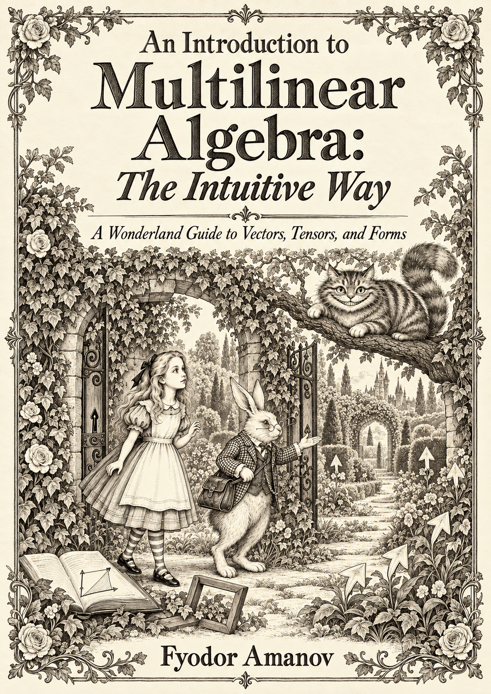
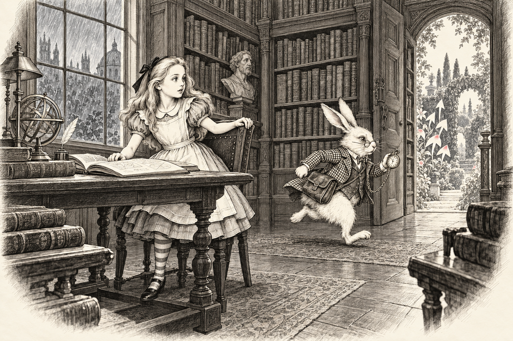
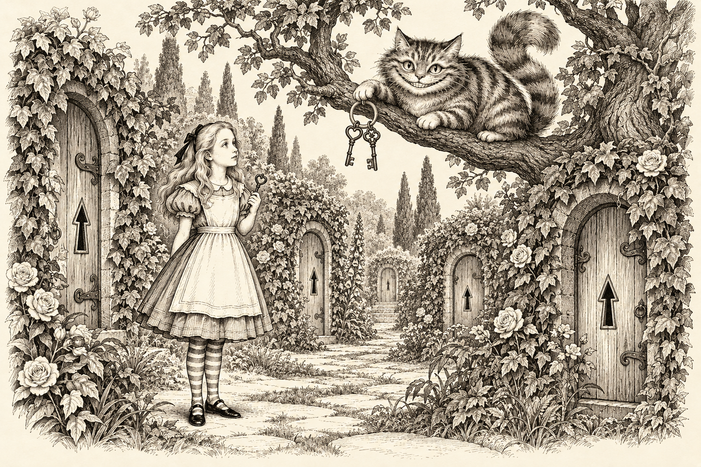
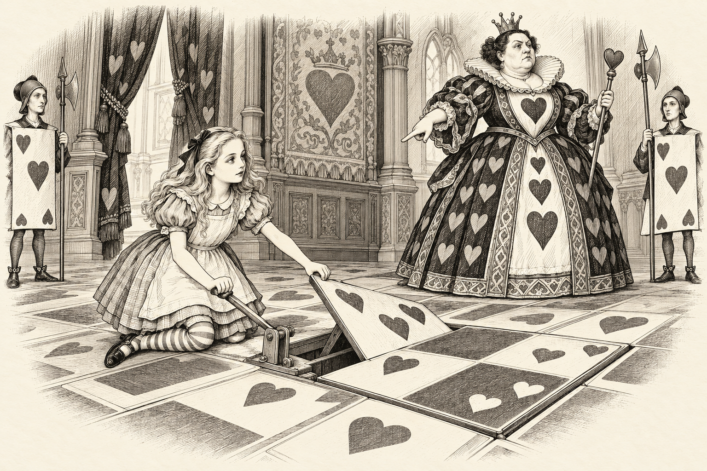
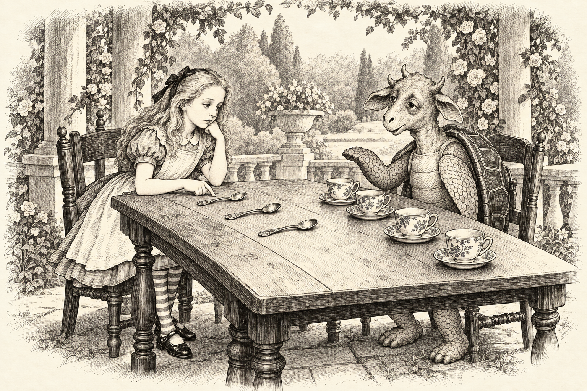
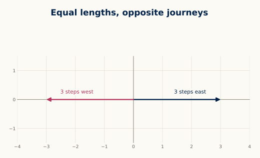
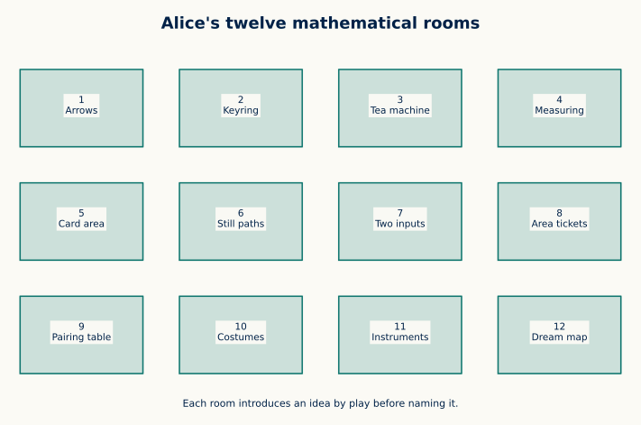

# An Introduction to Multilinear Algebra: The Intuitive Way

<div align="center">

**A Wonderland Guide to Vectors, Tensors, and Forms**<br>
*Follow Alice down the rabbit hole. Come back with a little more mathematics.*

### 📖 [Read the free book](https://fyodoramanov1.github.io/multilinear-algebra-book/) · [Download the PDF](https://fyodoramanov1.github.io/multilinear-algebra-book/downloads/book.pdf) · [Play with the demos](https://fyodoramanov1.github.io/multilinear-algebra-book/demos/)

<a href="https://fyodoramanov1.github.io/multilinear-algebra-book/">
  
</a>

**12 chapters · 12 interactive demos · 56 geometric teaching illustrations**<br>
**The complete first book is free.**

*By Fyodor Amanov*

</div>

## 🐇 A rabbit, a keyring, and a surprisingly mathematical adventure

The Cheshire Cat has a keyring. The Hatter has a machine. The Queen of Hearts has a square of playing cards that refuses to keep its shape.

Alice has questions.

Why can two arrows have the same length and mean different journeys? How can a few directions describe an entire space? What stays the same when the coordinates change?

This book follows those questions from **vectors and bases to tensors and differential forms**, through stories, pictures, worked examples, and experiments you can try yourself.

**Bring high-school mathematics and curiosity.** Each chapter begins with something concrete; the formal definitions arrive as the ideas take shape.

## ✨ A peek through four of the doors

<table>
  <tr>
    <td width="50%" align="center">
      <a href="https://fyodoramanov1.github.io/multilinear-algebra-book/chapters/01-vectors/">
        
      </a>
      <br><strong>Down the Arrow Hole</strong>
      <br>A hurried rabbit. A garden of arrows. The beginning of vectors.
    </td>
    <td width="50%" align="center">
      <a href="https://fyodoramanov1.github.io/multilinear-algebra-book/chapters/02-spaces/">
        
      </a>
      <br><strong>The Cat's Vanishing Keys</strong>
      <br>A small keyring opens an infinite garden. Meet a basis.
    </td>
  </tr>
  <tr>
    <td width="50%" align="center">
      <a href="https://fyodoramanov1.github.io/multilinear-algebra-book/chapters/05-determinants/">
        
      </a>
      <br><strong>The Queen's Card Square</strong>
      <br>Stretch it. Flip it. Flatten it. Discover the determinant.
    </td>
    <td width="50%" align="center">
      <a href="https://fyodoramanov1.github.io/multilinear-algebra-book/chapters/09-tensor-products/">
        
      </a>
      <br><strong>The Mock Turtle's Combination Table</strong>
      <br>Every pairing gets a place. A doorway into tensor products.
    </td>
  </tr>
</table>

*Click a picture to enter its chapter. Twelve Victorian-style pen-and-ink scenes accompany the journey.*

## 🧭 Pictures that help the ideas click

An arrow pointing east and an arrow pointing west can have the same length. They still take Alice to different places.

<a href="https://fyodoramanov1.github.io/multilinear-algebra-book/chapters/01-vectors/">
  
</a>

That is how the book starts: **an idea you can picture, followed by mathematics you can work through.**

Inside each chapter, you will find:

- **A story to follow:** Alice meets a new puzzle and a familiar Wonderland companion.
- **Intuition boxes and Alice's notebook:** plain-language explanations alongside precise definitions.
- **Worked examples and geometric illustrations:** the pictures use the same examples as the calculations.
- **An experiment to explore:** a browser demo, with QR links in the PDF.
- **Something to try yourself:** exercises, with hints and answers when you need them.

The later chapters take the ideas into stress, diffusion, inertia, geometry, and data. The story keeps going as the mathematics grows.

## 🎛️ Don't just read the geometry. Move it.

| Try this question | Open the playground |
| --- | --- |
| What happens when you add or scale two arrows? | [Vector Playground](https://fyodoramanov1.github.io/multilinear-algebra-book/demos/vector-playground/) |
| Can a point stay still while its coordinates change? | [Basis Explorer](https://fyodoramanov1.github.io/multilinear-algebra-book/demos/basis-explorer/) |
| What does a matrix actually do to a grid? | [Linear Map Theater](https://fyodoramanov1.github.io/multilinear-algebra-book/demos/linear-map-theater/) |
| When does a square flip, stretch, or collapse? | [Determinant Volume](https://fyodoramanov1.github.io/multilinear-algebra-book/demos/determinant-volume/) |

**[Explore all twelve interactive demos →](https://fyodoramanov1.github.io/multilinear-algebra-book/demos/)**

## 🗺️ Twelve rooms, one journey



| Room | The story | The mathematics |
| --- | --- | --- |
| 1 | [Down the Arrow Hole](https://fyodoramanov1.github.io/multilinear-algebra-book/chapters/01-vectors/) | Vectors, coordinates, addition, and scaling |
| 2 | [The Cat's Vanishing Keys](https://fyodoramanov1.github.io/multilinear-algebra-book/chapters/02-spaces/) | Spaces, independence, bases, and dimension |
| 3 | [The Hatter's Tea Machine](https://fyodoramanov1.github.io/multilinear-algebra-book/chapters/03-linear-maps/) | Linear maps, matrices, image, and kernel |
| 4 | [The Caterpillar's Measuring Tape](https://fyodoramanov1.github.io/multilinear-algebra-book/chapters/04-inner-products/) | Length, angle, projection, and orthogonality |
| 5 | [The Queen's Card Square](https://fyodoramanov1.github.io/multilinear-algebra-book/chapters/05-determinants/) | Determinants, signed area, and volume |
| 6 | [Paths That Refuse to Turn](https://fyodoramanov1.github.io/multilinear-algebra-book/chapters/06-eigenvectors/) | Eigenvectors, eigenvalues, and repeated transformations |
| 7 | [The Duchess's Two-Pan Balance](https://fyodoramanov1.github.io/multilinear-algebra-book/chapters/07-bilinear-forms/) | Bilinear forms and quadratic forms |
| 8 | [The Queen's Area Tickets](https://fyodoramanov1.github.io/multilinear-algebra-book/chapters/08-wedge-products/) | Wedge products and oriented areas |
| 9 | [The Mock Turtle's Combination Table](https://fyodoramanov1.github.io/multilinear-algebra-book/chapters/09-tensor-products/) | Tensor products and combinations of directions |
| 10 | [Humpty Dumpty's Word Costumes](https://fyodoramanov1.github.io/multilinear-algebra-book/chapters/10-components/) | Components, duality, and changes of basis |
| 11 | [The White Rabbit's Instrument Bag](https://fyodoramanov1.github.io/multilinear-algebra-book/chapters/11-applications/) | Tensors in physical and geometric applications |
| 12 | [Alice's Dream Map](https://fyodoramanov1.github.io/multilinear-algebra-book/chapters/12-forms/) | Differential forms, local change, and accumulated measurement |

## 🌱 The first story in a bigger series

I'm **Fyodor Amanov**, and this is my first book in a planned series explaining **mathematics and science through stories**.

I'm making the complete first volume free so more people can discover this way of learning. I intend future volumes to be paid releases, with the same emphasis on stories, illustrations, and exploration. Topics and publication dates have not yet been announced.

If a picture helped an idea click, tell me. If a passage left you puzzled, tell me that too. And if there is a subject you would love to meet through a story, **[suggest the next journey](https://github.com/FyodorAmanov1/multilinear-algebra-book/issues)**.

**Enjoyed the book?** Share the [website](https://fyodoramanov1.github.io/multilinear-algebra-book/) with a curious friend, student, or teacher. A star on this repository is welcome too. ⭐

---

<details>
<summary><strong>🛠️ Behind the scenes: build the book and website</strong></summary>

### Build locally

Install Python 3.12+, Pandoc, a LaTeX distribution with `pdflatex`, and Node.js for the build's JavaScript syntax checks. Then run:

```bash
python -m pip install -r requirements.txt
python scripts/build.py all
python scripts/build_pages.py
```

The PDF is written to `build/book/main.pdf`. The GitHub Pages website, including its downloadable PDF, is written to `build/public/`.

Preview it locally:

```bash
python scripts/serve.py --directory build/public
```

Open [the local preview](http://127.0.0.1:8000/multilinear-algebra-book/).

### Find your way around the source

| Folder | Inside |
| --- | --- |
| [`content/`](content/) | Chapters, demo descriptions, and exercise answers |
| [`assets/story/`](assets/story/) | The illustrated cover and Wonderland scenes |
| [`assets/figures/`](assets/figures/) | Geometric teaching diagrams |
| [`assets/js/`](assets/js/) | Interactive demo code |
| [`templates/`](templates/) | Book and website layouts |
| [`scripts/`](scripts/) | Illustration generation, book builds, and local preview |

GitHub Actions builds and publishes the website on pushes to `main` or `master`. The deployment uses `build/public/`; the website address and repository path are configured in [`content/book.json`](content/book.json).

</details>

## Licence

Book text and original illustrations: **[Creative Commons BY-NC 4.0](LICENSE.md)**. Share and adapt them with attribution for noncommercial use, under the licence terms.

Website, build scripts, and interactive demo code: **[MIT](LICENSE-CODE.md)**.

<div align="center">

**The rabbit is waiting. [Shall we begin? →](https://fyodoramanov1.github.io/multilinear-algebra-book/chapters/01-vectors/)**

</div>
