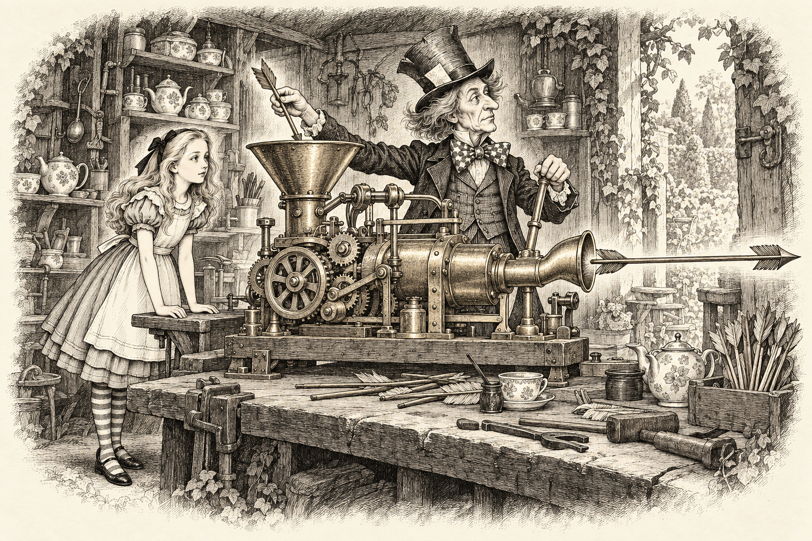
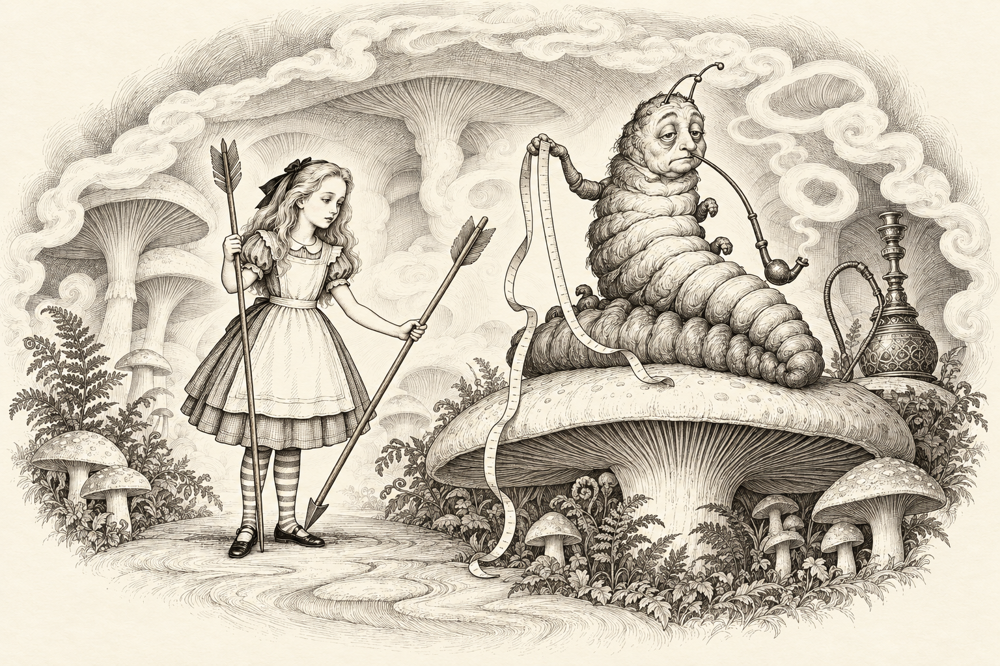
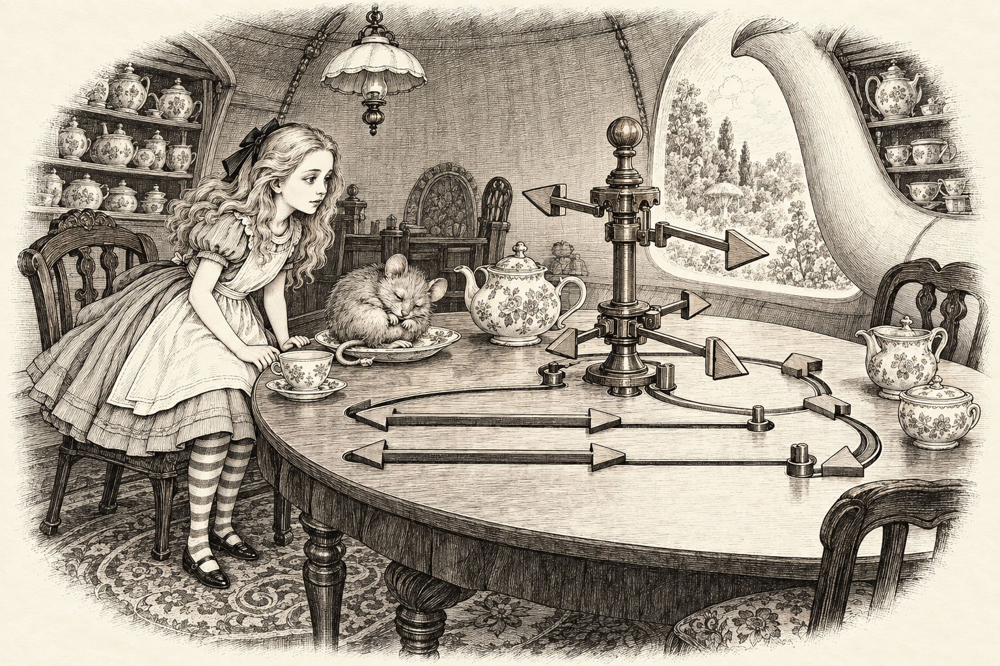
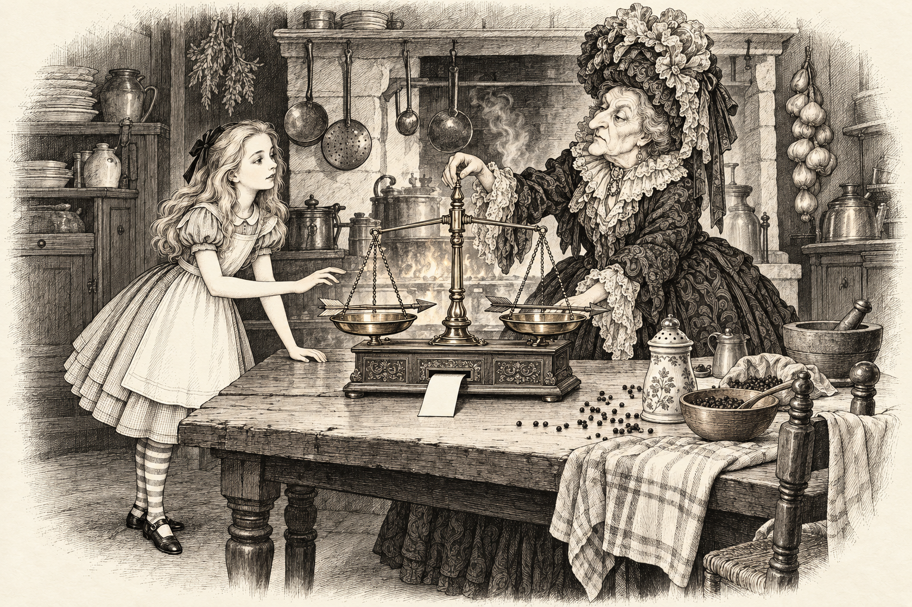
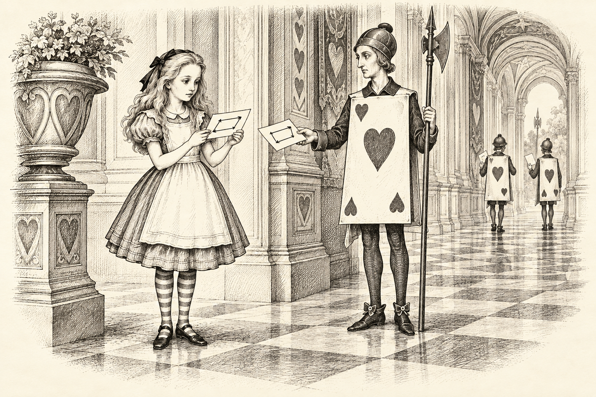
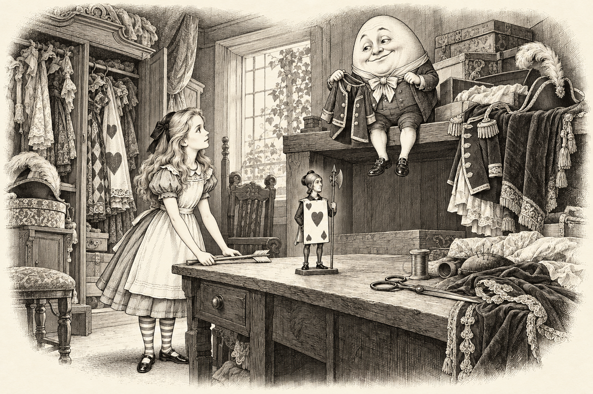
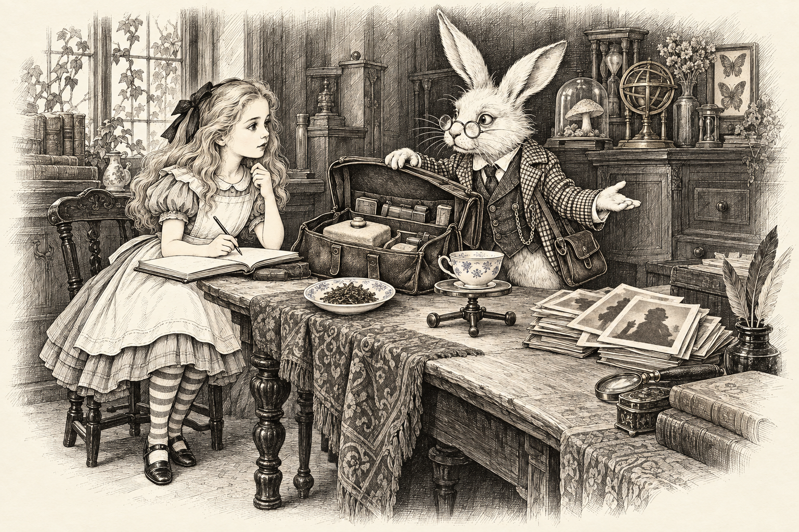
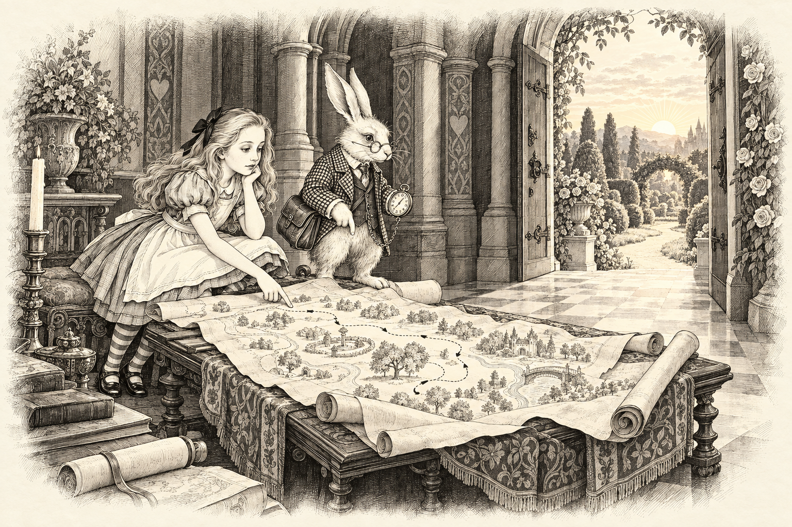
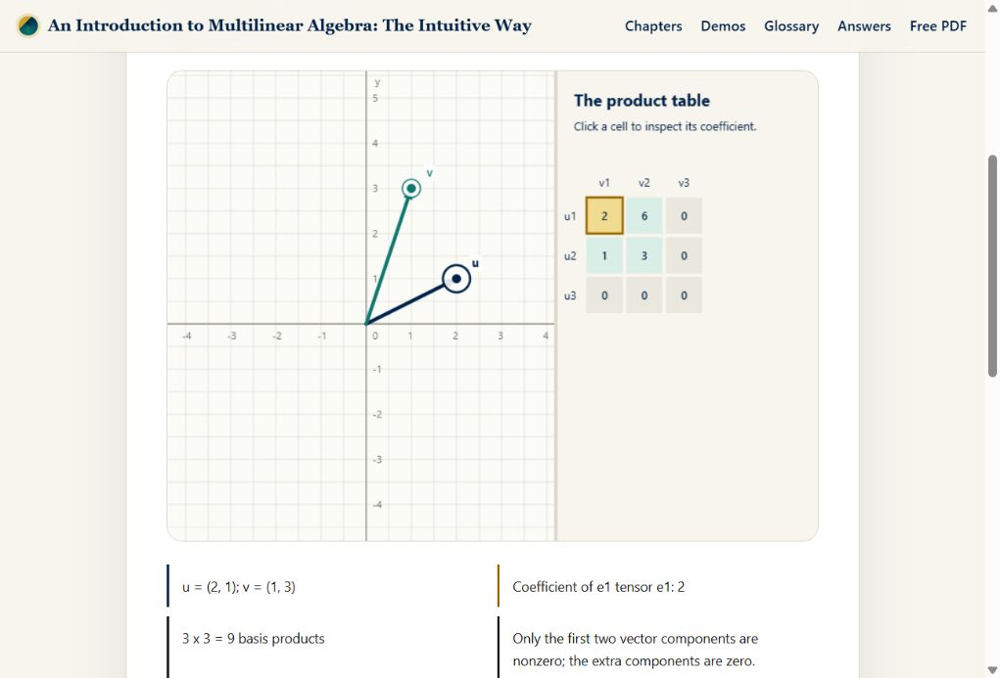

# An Introduction to Multilinear Algebra: The Intuitive Way

<div align="center">

**A Wonderland Guide to Vectors, Tensors, and Forms**<br>
*Follow Alice down the rabbit hole. Come back with a little more mathematics.*

### 📖 [Read the free book](https://fyodoramanov1.github.io/multilinear-algebra-book/) · [Download the PDF](https://fyodoramanov1.github.io/multilinear-algebra-book/downloads/book.pdf) · [Play with the demos](https://fyodoramanov1.github.io/multilinear-algebra-book/demos/)

<a href="https://fyodoramanov1.github.io/multilinear-algebra-book/">
  
</a>

**12 chapters · 12 interactive demos · 56 geometric teaching illustrations**<br>
**The complete first book is free.**

*By Fyodor Amanov*

</div>

## 🐇 A rabbit, a keyring, and a surprisingly mathematical adventure

The Cheshire Cat has a keyring. The Hatter has a machine. The Queen of Hearts has a square of playing cards that refuses to keep its shape.

Alice has questions.

Why can two arrows have the same length and mean different journeys? How can a few directions describe an entire space? What stays the same when the coordinates change?

This book follows those questions from **vectors and bases to tensors and differential forms**, through stories, pictures, worked examples, and experiments you can try yourself.

**Bring high-school mathematics and curiosity.** Each chapter begins with something concrete; the formal definitions arrive as the ideas take shape.

## 🗺️ Twelve rooms, one journey

Choose a door. Each picture and room name opens its chapter.

<table>
  <tr>
    <td width="50%" align="center" valign="top">
      <a href="https://fyodoramanov1.github.io/multilinear-algebra-book/chapters/01-vectors/">
        
      </a>
      <br><strong>Room 1</strong>
      <br><a href="https://fyodoramanov1.github.io/multilinear-algebra-book/chapters/01-vectors/"><strong>Down the Arrow Hole</strong></a>
    </td>
    <td width="50%" align="center" valign="top">
      <a href="https://fyodoramanov1.github.io/multilinear-algebra-book/chapters/02-spaces/">
        
      </a>
      <br><strong>Room 2</strong>
      <br><a href="https://fyodoramanov1.github.io/multilinear-algebra-book/chapters/02-spaces/"><strong>The Cat’s Vanishing Keys</strong></a>
    </td>
  </tr>
  <tr>
    <td width="50%" align="center" valign="top">
      <a href="https://fyodoramanov1.github.io/multilinear-algebra-book/chapters/03-linear-maps/">
        
      </a>
      <br><strong>Room 3</strong>
      <br><a href="https://fyodoramanov1.github.io/multilinear-algebra-book/chapters/03-linear-maps/"><strong>The Hatter’s Tea Machine</strong></a>
    </td>
    <td width="50%" align="center" valign="top">
      <a href="https://fyodoramanov1.github.io/multilinear-algebra-book/chapters/04-inner-products/">
        
      </a>
      <br><strong>Room 4</strong>
      <br><a href="https://fyodoramanov1.github.io/multilinear-algebra-book/chapters/04-inner-products/"><strong>The Caterpillar’s Measuring Tape</strong></a>
    </td>
  </tr>
  <tr>
    <td width="50%" align="center" valign="top">
      <a href="https://fyodoramanov1.github.io/multilinear-algebra-book/chapters/05-determinants/">
        
      </a>
      <br><strong>Room 5</strong>
      <br><a href="https://fyodoramanov1.github.io/multilinear-algebra-book/chapters/05-determinants/"><strong>The Queen’s Card Square</strong></a>
    </td>
    <td width="50%" align="center" valign="top">
      <a href="https://fyodoramanov1.github.io/multilinear-algebra-book/chapters/06-eigenvectors/">
        
      </a>
      <br><strong>Room 6</strong>
      <br><a href="https://fyodoramanov1.github.io/multilinear-algebra-book/chapters/06-eigenvectors/"><strong>Paths That Refuse to Turn</strong></a>
    </td>
  </tr>
  <tr>
    <td width="50%" align="center" valign="top">
      <a href="https://fyodoramanov1.github.io/multilinear-algebra-book/chapters/07-bilinear-forms/">
        
      </a>
      <br><strong>Room 7</strong>
      <br><a href="https://fyodoramanov1.github.io/multilinear-algebra-book/chapters/07-bilinear-forms/"><strong>The Duchess’s Two-Pan Balance</strong></a>
    </td>
    <td width="50%" align="center" valign="top">
      <a href="https://fyodoramanov1.github.io/multilinear-algebra-book/chapters/08-wedge-products/">
        
      </a>
      <br><strong>Room 8</strong>
      <br><a href="https://fyodoramanov1.github.io/multilinear-algebra-book/chapters/08-wedge-products/"><strong>The Queen’s Area Tickets</strong></a>
    </td>
  </tr>
  <tr>
    <td width="50%" align="center" valign="top">
      <a href="https://fyodoramanov1.github.io/multilinear-algebra-book/chapters/09-tensor-products/">
        
      </a>
      <br><strong>Room 9</strong>
      <br><a href="https://fyodoramanov1.github.io/multilinear-algebra-book/chapters/09-tensor-products/"><strong>The Mock Turtle’s Combination Table</strong></a>
    </td>
    <td width="50%" align="center" valign="top">
      <a href="https://fyodoramanov1.github.io/multilinear-algebra-book/chapters/10-components/">
        
      </a>
      <br><strong>Room 10</strong>
      <br><a href="https://fyodoramanov1.github.io/multilinear-algebra-book/chapters/10-components/"><strong>Humpty Dumpty’s Word Costumes</strong></a>
    </td>
  </tr>
  <tr>
    <td width="50%" align="center" valign="top">
      <a href="https://fyodoramanov1.github.io/multilinear-algebra-book/chapters/11-applications/">
        
      </a>
      <br><strong>Room 11</strong>
      <br><a href="https://fyodoramanov1.github.io/multilinear-algebra-book/chapters/11-applications/"><strong>The White Rabbit’s Instrument Bag</strong></a>
    </td>
    <td width="50%" align="center" valign="top">
      <a href="https://fyodoramanov1.github.io/multilinear-algebra-book/chapters/12-forms/">
        
      </a>
      <br><strong>Room 12</strong>
      <br><a href="https://fyodoramanov1.github.io/multilinear-algebra-book/chapters/12-forms/"><strong>Alice’s Dream Map</strong></a>
    </td>
  </tr>
</table>

## 🧭 Pictures that help the ideas click

An arrow pointing east and an arrow pointing west can have the same length. They still take Alice to different places.

<a href="https://fyodoramanov1.github.io/multilinear-algebra-book/chapters/01-vectors/">
  
</a>

That is how the book starts: **an idea you can picture, followed by mathematics you can work through.**

Inside each chapter, you will find:

- **A story to follow:** Alice meets a new puzzle and a familiar Wonderland companion.
- **Intuition boxes and Alice's notebook:** plain-language explanations alongside precise definitions.
- **Worked examples and geometric illustrations:** the pictures use the same examples as the calculations.
- **An experiment to explore:** a diagram you can drag and click, with QR links in the PDF.
- **Something to try yourself:** exercises, with hints and answers when you need them.

The later chapters take the ideas into stress, diffusion, inertia, geometry, and data. The story keeps going as the mathematics grows.

## 🎛️ Move the geometry yourself

**Grab an arrow. Move a point. Watch the mathematics respond.**

All twelve demos let you manipulate the diagram directly with a mouse or touch. Drag a colored ring to move a vector or point, or choose an object and click the grid to place it. The geometry, coordinates, and sliders update together.



*Two arrows become a table of pairings. Move either arrow, then click a cell to inspect its coefficient.*

| Playground | What you can grab or click |
| --- | --- |
| [Vector Playground](https://fyodoramanov1.github.io/multilinear-algebra-book/demos/vector-playground/) | Drag u and v; watch their sum, difference, and scaled vector respond. |
| [Basis Explorer](https://fyodoramanov1.github.io/multilinear-algebra-book/demos/basis-explorer/) | Move both basis arrows and the point. Bring the directions into line to see when they stop forming a basis. |
| [Linear Map Theater](https://fyodoramanov1.github.io/multilinear-algebra-book/demos/linear-map-theater/) | Drag the matrix columns to reshape the grid; move an input point to explore its image. |
| [Inner Product Lab](https://fyodoramanov1.github.io/multilinear-algebra-book/demos/inner-product-lab/) | Move two vector tips to explore angles, dot products, projections, and orthogonality. |
| [Determinant Volume](https://fyodoramanov1.github.io/multilinear-algebra-book/demos/determinant-volume/) | Drag the columns to stretch, reverse, or collapse a parallelogram and its signed area. |
| [Eigenvector Dance](https://fyodoramanov1.github.io/multilinear-algebra-book/demos/eigenvector-dance/) | Move the matrix columns and a starting vector; try aligning it with an eigenvector direction. |
| [Bilinear Form Lab](https://fyodoramanov1.github.io/multilinear-algebra-book/demos/bilinear-form-lab/) | Drag a test vector through the colored field, or reshape the form through its column handles. |
| [Wedge Areas](https://fyodoramanov1.github.io/multilinear-algebra-book/demos/wedge-areas/) | Move the arrows to build an oriented area, flatten it, or reverse its orientation. |
| [Tensor Product Builder](https://fyodoramanov1.github.io/multilinear-algebra-book/demos/tensor-product-builder/) | Drag both factors and click the product table to inspect individual coefficients. |
| [Component Transformer](https://fyodoramanov1.github.io/multilinear-algebra-book/demos/component-transformer/) | Turn the basis arrows around the origin and move the object to explore its changing components. |
| [Tensor Applications](https://fyodoramanov1.github.io/multilinear-algebra-book/demos/tensor-applications/) | Drag the principal stress handles and the diffusion control to reshape the tensor and its field. |
| [Forms and Fields](https://fyodoramanov1.github.io/multilinear-algebra-book/demos/forms-and-fields/) | Move a 1-form, its test vector, and an area-patch corner to explore signed measurements. |

**Your playground, your pace.** Use **Play animation** to follow the motion or **Reset example** to return to the starting picture. Frame handles rotate around the origin; stress handles follow their diagonal axes.

**Keyboard explorers are welcome:** choose an object, focus the grid, and use the arrow keys. Hold **Shift** for larger steps or press **Home** to reset. Sliders, selectors, and the product-coefficient inspector also work with the keyboard.

**[Enter the twelve interactive playgrounds](https://fyodoramanov1.github.io/multilinear-algebra-book/demos/)**

## 🌱 The first story in a bigger series

I'm **Fyodor Amanov**, and this is my first book in a planned series explaining **mathematics and science through stories**.

I'm making the complete first volume free so more people can discover this way of learning. 

If a picture helped an idea click, tell me. If a passage left you puzzled, tell me that too. And if there is a subject you would love to meet through a story, **[suggest the next journey](https://github.com/FyodorAmanov1/multilinear-algebra-book/issues)**.

**Enjoyed the book?** Share the [website](https://fyodoramanov1.github.io/multilinear-algebra-book/) with a curious friend, student, or teacher. A star on this repository is welcome too. ⭐

---

<details>
<summary><strong>🛠️ Behind the scenes: build the book and website</strong></summary>

### Build locally

Install Python 3.12+, Pandoc, a LaTeX distribution with `pdflatex`, and Node.js for the build's JavaScript syntax checks. Then run:

```bash
python -m pip install -r requirements.txt
python scripts/build.py all
python scripts/build_pages.py
```

The PDF is written to `build/book/main.pdf`. The GitHub Pages website, including its downloadable PDF, is written to `build/public/`.

Preview it locally:

```bash
python scripts/serve.py --directory build/public
```

Open [the local preview](http://127.0.0.1:8000/multilinear-algebra-book/).

### Find your way around the source

| Folder | Inside |
| --- | --- |
| [`content/`](content/) | Chapters, demo descriptions, and exercise answers |
| [`assets/story/`](assets/story/) | The illustrated cover and Wonderland scenes |
| [`assets/figures/`](assets/figures/) | Geometric teaching diagrams |
| [`assets/js/`](assets/js/) | Interactive demo code |
| [`templates/`](templates/) | Book and website layouts |
| [`scripts/`](scripts/) | Illustration generation, book builds, and local preview |

GitHub Actions builds and publishes the website on pushes to `main` or `master`. The deployment uses `build/public/`; the website address and repository path are configured in [`content/book.json`](content/book.json).

</details>

## Licence

Book text and original illustrations: **[Creative Commons BY-NC 4.0](LICENSE.md)**. Share and adapt them with attribution for noncommercial use, under the licence terms.

Website, build scripts, and interactive demo code: **[MIT](LICENSE-CODE.md)**.

<div align="center">

**The rabbit is waiting. [Shall we begin? →](https://fyodoramanov1.github.io/multilinear-algebra-book/chapters/01-vectors/)**

</div>
